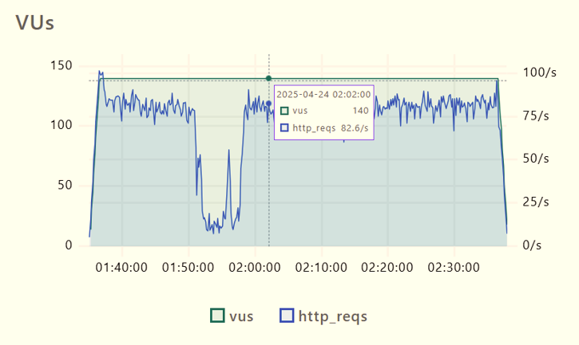

# Informe de resultados de la prueba de carga

**Ejercicio 4 — Análisis de resultados** · Prueba ejecutada el 24/04/2025 · Informe del 14/11/2026

## 1. Ficha de la prueba

| Dato | Valor |
|---|---|
| Transacción bajo prueba | `App Transaction Balance` (consulta de saldo) |
| Fecha y hora | 24/04/2025, de 01:35 a 02:38 aproximadamente |
| Duración | 3.780,6 s = **63,0 minutos** |
| Carga aplicada | **140 usuarios virtuales constantes** (modelo cerrado) |
| Peticiones ejecutadas | **276.650** (73,18 peticiones/s de media) |
| Errores | **6.759 (2,44 %)** |
| Herramienta | k6 (resumen `textSummary.txt`) + monitoreo en Grafana |
| Insumos analizados | `textSummary.txt` y el diagrama de VUs vs peticiones/s, ambos en el anexo |

**Veredicto: la prueba no debería darse por aprobada.** El servicio sufrió una
degradación severa de unos 9 minutos en mitad de la ejecución, y las métricas
agregadas la esconden casi por completo.

## 2. Resumen ejecutivo

Durante 63 minutos se mantuvo una carga constante de 140 usuarios virtuales contra la
transacción de consulta de saldo. El servicio respondió bien la mayor parte del tiempo
—mediana de 613 ms y mínimo de 192 ms— pero entre las 01:50 y las 01:59
aproximadamente el rendimiento se desplomó: **sin que la carga cambiara, las peticiones
atendidas por segundo cayeron de unas 82 a unas 12, un 85 % menos**, y volvieron a su
nivel normal de golpe unos nueve minutos después.

Ese episodio explica prácticamente todo lo malo del resultado:

- Los **6.759 errores** de la prueba (2,44 % del total) están concentrados: el 99,96 %
  se registró en la etapa 1 —la meseta de carga sostenida— y el 88,6 % son errores
  **5xx**, es decir, fallos del servidor, no de los datos de prueba ni del cliente.
- Las peticiones que fallaron tardaron **5,9 segundos de media**, frente a los 0,74 s
  de las que tuvieron éxito. No es un rechazo rápido: el servidor retiene la petición,
  consume recursos y luego falla.
- El **p95 global, 1,57 s, queda por encima de un umbral de 1,5 s**, mientras que el
  p95 de las peticiones exitosas, 1,42 s, lo cumple. La cola de tiempos la fabrican
  los errores.
- Se dejaron de atender unas **33.000 peticiones** respecto a lo que la prueba habría
  cursado sin el incidente: alrededor del 11 % del volumen esperado.

El hallazgo más importante no es ninguno de esos números por separado, sino lo que
pasa al mirarlos juntos: **una tasa de error agregada del 2,44 % "aprueba" un criterio
de menos del 3 %, mientras oculta una ventana de nueve minutos en la que el servicio
estuvo, en la práctica, caído.** Un informe que se quedara en el promedio daría por
buena una prueba que documenta una interrupción.

## 3. Qué se ejecutó, según lo que dicen los propios datos

El resumen no incluye el script, pero sus métricas permiten reconstruir el escenario,
y conviene dejarlo escrito porque condiciona cómo se leen los resultados:

- **Una petición por iteración.** `http_reqs` e `iterations` valen exactamente lo
  mismo (276.650) y tienen la misma tasa (73,176857/s).
- **Una pausa de 1 segundo por iteración.** La diferencia entre la duración de la
  iteración y la de la petición es de 1,0 s tanto en la media (1,86 − 0,86) como en la
  mediana (1,61 − 0,61).
- **Tres etapas.** Los contadores de error están segmentados en `stage_0`, `stage_1` y
  `stage_2`, y el diagrama muestra la forma clásica de trapecio: subida rápida, meseta
  larga y bajada rápida. La etapa 1 es la meseta.
- **Hubo función `setup`**, que el resumen marca explícitamente.
- **Modelo cerrado**: 140 usuarios virtuales fijos (`vus_max` con mínimo y máximo de
  140). Este punto se retoma en el hallazgo 7, porque cambia la interpretación de todo
  lo demás.

La aritmética cierra sobre sí misma, lo que da confianza en la reconstrucción: 140 VUs
durante 3.780,6 s son 529.284 segundos-VU disponibles; las peticiones consumieron
276.650 × 0,862 s = 238.384 y las pausas 276.650 × 1 s = 276.650. Entre las dos suman
515.034, el 97 % del total, y el 3 % restante se explica por las rampas de subida y
bajada.

## 4. Análisis de los resultados

### 4.1 Volumen y rendimiento

| Métrica | Valor | Lectura |
|---|---|---|
| Peticiones totales | 276.650 | Volumen alto, muestra más que suficiente |
| Rendimiento medio | 73,18 peticiones/s | Media de toda la ejecución, **incluido el incidente** |
| Rendimiento sostenido | ~82 peticiones/s | Lo que se ve en el diagrama fuera del incidente |
| Duración | 3.780,6 s (63,0 min) | Prueba de estabilidad, no de pico |
| Datos recibidos | 842 MB (223 kB/s) | 3,04 kB por respuesta |
| Datos enviados | 588 MB (156 kB/s) | 2,13 kB por petición |

La duración no aparece en el resumen, pero se deduce de cualquiera de los contadores y
el resultado coincide en todos: 276.650 / 73,176857 = 3.780,6 s; 769 / 0,203409 =
3.780,6 s; 5.987 / 1,583625 = 3.780,9 s; 842 MB / 223 kB/s = 3.776 s. También coincide
con el eje temporal del diagrama.

Conviene no confundir las dos cifras de rendimiento. **73,18/s es la media de la
ejecución completa; el servicio sostenía en realidad unas 82/s**, y la diferencia es
exactamente el coste del incidente. Informar solo la media subestima la capacidad real
del servicio y, a la vez, esconde su peor momento.

La ley de Little confirma que las cifras son coherentes entre sí: rendimiento ×
duración de la iteración = 73,18/s × 1,86 s = **136 usuarios virtuales**, prácticamente
los 140 configurados. La concurrencia efectiva —peticiones realmente en vuelo— fue de
unas 65, porque cada usuario pasa el 54 % de su iteración en la pausa de 1 s.

### 4.2 Tiempos de respuesta

| Estadístico | Todas las peticiones | Solo las exitosas | Diferencia |
|---|---|---|---|
| Mínimo | 191,86 ms | 244,92 ms | — |
| Media | 861,68 ms | 735,84 ms | +126 ms |
| Mediana | 613,42 ms | 600,70 ms | +13 ms |
| p90 | 1,28 s | 1,22 s | +60 ms |
| p95 | **1,57 s** | **1,42 s** | +150 ms |
| Máximo | 29,93 s | 26,72 s | +3,2 s |

Tres lecturas:

**La mediana está sana y la cola no.** La mitad de las peticiones se resolvió por
debajo de 613 ms, pero entre el p90 y el máximo hay un salto de 1,28 s a 29,93 s. Esa
distribución —centro bueno, cola larguísima— es la firma de un problema intermitente,
no de un servicio uniformemente lento.

**Los errores son los que empujan la cola.** Al separar las peticiones exitosas, todos
los estadísticos mejoran, y el p95 cruza el umbral de 1,5 s en un sentido o en otro
según se incluyan o no los fallos. De las dos cifras, la que hay que reportar contra un
acuerdo de servicio es la global (1,57 s): el usuario que recibe un error también
esperó.

**El tiempo es del servidor, no de la red ni del cliente.** `http_req_waiting` —el
tiempo hasta el primer byte— vale 861,21 ms de media sobre los 861,68 ms del total: el
99,95 %. Todo lo demás es despreciable: bloqueo 10,97 µs, conexión 3,3 µs, handshake
TLS 7,36 µs, envío 43,22 µs, recepción 424,03 µs. Los valores de conexión y TLS en el
orden de los microsegundos confirman además que la reutilización de conexiones
funcionó y que el generador de carga no fue el cuello de botella. **Cualquier
investigación tiene que mirar al backend, no a la red ni a la máquina de pruebas.**

### 4.3 Errores

| Etapa | Código | Cantidad | % de los errores |
|---|---|---|---|
| Etapa 0 (subida) | 5xx | 1 | 0,01 % |
| **Etapa 1 (meseta)** | **4xx** | **769** | **11,38 %** |
| **Etapa 1 (meseta)** | **5xx** | **5.987** | **88,58 %** |
| Etapa 2 (bajada) | 5xx | 2 | 0,03 % |
| **Total** | | **6.759** | **100 %** |

Los cuatro contadores suman exactamente los 6.759 fallos que reporta
`http_req_failed`, así que la clasificación cubre el 100 % de los errores y no hay
fallos sin categorizar. De ahí salen dos conclusiones directas:

- **El 99,96 % de los errores ocurrió en la meseta**, no en las rampas. Si el error
  estuviera repartido de forma uniforme (2,44 % en todo momento), la rampa de subida
  habría acumulado decenas de fallos; registró uno. El problema no es "el sistema falla
  un 2,44 % de las veces": es "el sistema falló durante un rato".
- **El 88,6 % son 5xx**: el servidor falló al procesar peticiones que, hasta ese
  momento, había atendido bien con la misma carga y los mismos datos. Los 769 errores
  4xx (11,4 %) merecen un desglose aparte, porque el resumen no distingue si son 401,
  429 u otra cosa, y un 429 significaría que hubo limitación de tasa.

El dato más incómodo es el coste de los errores. Despejando la media de las peticiones
exitosas de la media global:

```
(861,68 ms x 276.650) - (735,84 ms x 269.891) = 39.787 s
39.787 s / 6.759 peticiones fallidas = 5,89 s por petición fallida
```

**Una petición que falla tarda 5,9 segundos de media; una que funciona, 0,74 s.** El
servicio no rechaza rápido: acepta la petición, la retiene y falla ocho veces más tarde
de lo que tarda en responder bien. Esos 39.787 segundos de tiempo de usuario virtual
—casi 11 horas-VU— se consumieron en peticiones que no sirvieron para nada y que,
mientras tanto, mantuvieron ocupados recursos del servidor.

### 4.4 El diagrama de usuarios virtuales frente a peticiones por segundo



Es la pieza más informativa de todo el material, y dice algo que el resumen no puede
decir: **cuándo** pasó lo que pasó.

**Lo que muestra cada serie.** La línea verde (`vus`, eje izquierdo) está plana en 140
de principio a fin: la carga aplicada no varió en ningún momento. La línea azul
(`http_reqs`, eje derecho, 0 a 100/s) es el trabajo que el sistema consiguió completar.
El punto de referencia que marca el propio gráfico —24/04/2025 02:02:00, 140 VUs y
82,6 peticiones/s— corresponde ya a la fase recuperada.

**Lo que pasó.** Entre el arranque y las 01:50 el servicio sostuvo entre 80 y 90
peticiones/s con normalidad. A partir de las 01:50 la línea azul cae en picado hasta
estabilizarse en torno a 10-17 peticiones/s, y se mantiene así unos nueve minutos,
hasta que alrededor de las 01:58-02:00 se recupera de forma abrupta y vuelve al nivel
anterior durante el resto de la hora. La caída máxima supone un **85 % menos de
rendimiento**. El resto de la prueba, incluida la última media hora, transcurre sin
anomalías.

**Por qué esto es grave aunque los VUs no se muevan.** En una prueba de modelo cerrado
el rendimiento no es una entrada, es un resultado: cada usuario virtual envía su
siguiente petición solo cuando ha recibido la anterior. Con la carga fija, rendimiento
y tiempo de respuesta son dos formas de mirar el mismo número, y la ley de Little
permite pasar de uno al otro:

```
tiempo de iteracion = usuarios virtuales / peticiones por segundo
  fuera del incidente : 140 / 82  = 1,7 s   ->  ~0,7 s de respuesta + 1 s de pausa
  dentro del incidente: 140 / 12  = 11,7 s  ->  ~10,7 s de respuesta + 1 s de pausa
```

Es decir: **el desplome del gráfico es, en realidad, un tiempo de respuesta que pasó de
unos 0,7 s a unos 10,7 segundos, quince veces peor**. Y encaja con el máximo de 29,93 s
que reporta el resumen, con los 5,9 s de media de las peticiones fallidas y con el
hecho de que casi todos los errores estén en esa etapa. El gráfico, el resumen y los
contadores de error cuentan la misma historia desde tres sitios distintos.

**Lo que costó.** A 82 peticiones/s durante los 3.780,6 s de la prueba se habrían
cursado unas 310.000 peticiones; se cursaron 276.650. Faltan **unas 33.000, el 11 % del
volumen esperado**, y eso es solo lo que dejó de intentarse: en producción, con
usuarios reales, esas peticiones no desaparecen, se acumulan.

**La tasa de error real de esa ventana.** La ventana duró unos 9 minutos (540 s) a un
rendimiento medio de unas 15 peticiones/s, es decir, del orden de 8.000 peticiones
cursadas. En esa misma fase se registraron 6.756 errores. Aun tomando el extremo
conservador del rango, **la tasa de error durante el incidente fue de decenas de puntos
porcentuales —del orden del 80 %—, no del 2,44 %**. Durante nueve minutos el servicio
no estuvo degradado: estuvo, a efectos prácticos, caído.

**Qué dato cerraría la demostración.** La correlación es sólida —la caída de
rendimiento, la concentración de errores en la etapa 1, el tiempo medio de las
peticiones fallidas y el máximo de 29,93 s apuntan todos al mismo episodio—, pero es
correlación: el `textSummary` es agregado y no permite ubicar cada error en el tiempo.
La confirmación definitiva es una serie temporal de errores por segundo superpuesta a
este mismo gráfico, que se obtiene exportando las métricas de k6 a una base de series
temporales (ver recomendación 8).

## 5. Hallazgos

### Hallazgo 1 — Interrupción del servicio de ~9 minutos con la carga constante
**Severidad: crítica**

Sin que los usuarios virtuales variaran de 140, el rendimiento cayó un 85 % (de ~82 a
~12 peticiones/s) durante unos nueve minutos, el 14 % de la prueba, y se recuperó solo.
Traducido por la ley de Little, el tiempo de respuesta pasó de ~0,7 s a ~10,7 s.

*Evidencia: diagrama de VUs vs peticiones/s; máximo de 29,93 s en el resumen.*

### Hallazgo 2 — Los errores son del servidor y están concentrados
**Severidad: crítica**

El 88,6 % de los 6.759 errores son 5xx y el 99,96 % se registró en la etapa de carga
sostenida. No es un error disperso ni atribuible a los datos de prueba: es el backend
fallando en una ventana concreta.

*Evidencia: contadores `y_failed_request_stage_*`, que suman exactamente los 6.759
fallos de `http_req_failed`.*

### Hallazgo 3 — Las peticiones que fallan tardan 5,9 s de media
**Severidad: alta**

Frente a 0,74 s de las exitosas. El sistema no rechaza rápido: retiene la petición,
ocupa recursos y falla tarde, lo que realimenta la saturación y empeora la cola de
tiempos del resto. En total, 39.787 segundos de tiempo de usuario virtual se gastaron
en peticiones fallidas.

*Evidencia: diferencia entre `http_req_duration` global y el submétrico
`expected_response:true`.*

### Hallazgo 4 — El p95 global incumple el umbral de 1,5 s; el de las exitosas no
**Severidad: alta**

1,57 s frente a 1,42 s. La diferencia la fabrican los errores. Reportar solo el p95 de
las transacciones correctas —una práctica habitual— daría por cumplido un acuerdo que
no se cumplió.

*Evidencia: `http_req_duration` p(95)=1.57s y `{expected_response:true}` p(95)=1.42s.*

### Hallazgo 5 — La media esconde la caída: 2,44 % agregado frente a ~80 % en la ventana
**Severidad: alta (metodológica)**

Es el hallazgo central del análisis. Una tasa de error del 2,44 % pasa cualquier
criterio de "menos del 3 %", pero se obtiene repartiendo una interrupción de nueve
minutos entre 63 minutos de buen funcionamiento. Los criterios de aceptación agregados
no detectan interrupciones: hay que evaluarlos también por ventana.

*Evidencia: 6.756 errores concentrados en una ventana que cursó del orden de 8.000
peticiones.*

### Hallazgo 6 — El tiempo consumido es del servidor, no de la red ni del cliente
**Severidad: informativa (acota dónde investigar)**

`http_req_waiting` es el 99,95 % de `http_req_duration`. Conexión (3,3 µs), handshake
TLS (7,36 µs) y envío (43,22 µs) son despreciables, lo que además confirma que las
conexiones se reutilizaron y que el generador de carga tenía margen de sobra. La
investigación debe centrarse en el backend y sus dependencias.

### Hallazgo 7 — El modelo cerrado amortiguó el incidente: el impacto medido es un piso
**Severidad: alta (interpretación)**

Con 140 usuarios virtuales fijos, cuando el servidor se frena la prueba automáticamente
deja de pedir: de 82 peticiones/s pasó a exigir 12. Un usuario real no espera a que le
respondan para volver a intentarlo, y el tráfico entrante no baja porque el sistema
esté lento. **En producción, esa misma avería habría producido una acumulación de
peticiones en cola, tiempos peores y probablemente más errores que los medidos aquí.**
Lo observado es el mejor escenario posible, no el esperable.

### Hallazgo 8 — Fuera del incidente, el servicio funciona bien
**Severidad: ninguna (verificación positiva)**

Mediana de 613 ms, mínimo de 192 ms, p90 de 1,28 s y unas 82 peticiones/s sostenidas
durante más de 50 minutos sin degradación acumulativa: ni la media sube con el tiempo
ni aparecen fugas visibles. **El problema detectado es de estabilidad, no de capacidad
base**, y esa distinción cambia por completo la línea de investigación.

### Hallazgo 9 — Los datos disponibles no permiten ubicar los errores en el tiempo
**Severidad: media (observabilidad del proceso de pruebas)**

El `textSummary` es un agregado del final de la ejecución y el diagrama solo tiene dos
series (VUs y peticiones/s). Todo el análisis temporal de este informe se apoya en una
correlación muy consistente, pero no en una medición directa. Faltan: errores por
segundo, percentiles por ventana y el desglose de los códigos 4xx.

### Observaciones menores

- **Volumen de subida inusualmente alto para una consulta:** 2,13 kB enviados por
  petición (588 MB en total). Conviene confirmar si corresponde a cabeceras y token o a
  un cuerpo de petición que podría aligerarse.
- **El máximo de 29,93 s sugiere un timeout muy largo** (del orden de 30 o 60 s). Una
  petición que lleva medio minuto en curso ya no le sirve a nadie y sigue ocupando
  recursos en los dos extremos.
- **Los 769 errores 4xx no están desglosados.** Si entre ellos hubiera 429, significaría
  que algún componente aplicó limitación de tasa, y esa es una explicación posible del
  episodio que hoy no se puede ni confirmar ni descartar.

## 6. Conclusiones

**1. La prueba no debería darse por aprobada.** Documenta una interrupción de unos
nueve minutos en la que el servicio dejó de atender el 85 % del trabajo y acumuló el
99,96 % de los errores de toda la ejecución. Que la tasa de error agregada quede por
debajo del 3 % no cambia ese hecho; lo esconde.

**2. El problema es de estabilidad, no de capacidad.** Con 140 usuarios virtuales el
servicio sostuvo unas 82 peticiones/s con una mediana de 613 ms durante más de 50
minutos. No se degradó progresivamente ni mostró señales de agotamiento sostenido:
falló en un episodio puntual y se recuperó solo, sin intervención. Eso apunta a una
causa transitoria —una pausa larga de recolección de basura, el agotamiento de un pool
de conexiones, el reinicio o el reemplazo de una instancia, un bloqueo en base de datos
o la caída temporal de una dependencia— y no a falta de recursos para el volumen
probado.

**3. La forma de fallar es tan preocupante como el fallo.** Las peticiones no se
rechazan: se retienen 5,9 segundos de media y luego devuelven 5xx. Ese patrón consume
capacidad mientras dura la avería, alarga la cola de tiempos de las peticiones sanas y
convierte un problema local en uno generalizado.

**4. El impacto real sería mayor que el medido.** El diseño de modelo cerrado hizo que
la propia prueba bajara el ritmo cuando el servidor se frenó. Con tráfico real, que no
se autorregula, la misma avería habría generado acumulación de peticiones, más
reintentos y un deterioro mayor.

**5. Hay una lección de método, y es la más reutilizable:** las métricas agregadas de
una prueba larga pueden ocultar una interrupción completa. Mirar el gráfico de VUs
frente a peticiones por segundo —dos líneas que deberían moverse juntas y aquí se
separan durante nueve minutos— fue lo que permitió encontrarla. Ningún percentil del
resumen la señalaba.

## 7. Recomendaciones

### Sobre el servicio y la plataforma

1. **Investigar la ventana 01:50-02:00 del 24/04/2025** en los registros del servicio,
   del APM y de la infraestructura. Es una fecha y una franja concretas: hay que buscar
   pausas de recolección de basura, saturación o agotamiento del pool de conexiones,
   bloqueos o esperas en base de datos, reinicios y reemplazos de instancias, eventos
   de autoescalado y errores de dependencias externas. **Es la acción de mayor
   prioridad**: sin causa raíz, el resto son paliativos.
2. **Revisar por qué un fallo tarda 5,9 segundos.** Ajustar los tiempos de espera a lo
   que el negocio realmente puede esperar, aplicar *fail fast* y añadir un cortacircuito
   hacia las dependencias, de modo que una avería degrade el servicio en vez de
   bloquearlo.
3. **Desglosar los 769 errores 4xx** por código. Si aparecen 429, revisar los límites
   de tasa configurados en el balanceador, la pasarela o el propio servicio.
4. **Revisar el tamaño de la petición** (2,13 kB de subida por consulta): a 82
   peticiones/s son 175 kB/s de tráfico entrante que quizá puedan reducirse.

### Sobre los criterios de aceptación

5. **Evaluar la tasa de error por ventana además de en agregado.** Un criterio del tipo
   "ningún intervalo de 1 minuto por encima del 5 % de error" habría marcado esta prueba
   como fallida en el momento en que ocurrió. El umbral agregado del 3 % se cumple y no
   sirvió para nada.
6. **Reportar el p95 global, no solo el de las transacciones exitosas**, y acompañarlo
   siempre del máximo y del porcentaje de peticiones por encima del umbral.
7. **Añadir un criterio de continuidad**: ningún intervalo con el rendimiento por debajo
   de un porcentaje del valor sostenido (por ejemplo, el 50 %). Es la forma directa de
   que una caída como esta falle la prueba automáticamente.

### Sobre el diseño y la instrumentación de las pruebas

8. **Exportar las métricas a una base de series temporales** (InfluxDB, Prometheus) en
   lugar de quedarse con el resumen final, y graficar errores por segundo y percentiles
   móviles junto a VUs y peticiones/s. Es lo que convierte la correlación de este
   informe en una medición.
9. **Repetir la prueba con un modelo abierto** (en k6, `constant-arrival-rate`), que fija
   las peticiones por segundo en lugar de los usuarios concurrentes. Es la única forma de
   conocer la capacidad real del servicio y de reproducir lo que ocurriría en producción
   durante una avería, donde el tráfico entrante no se frena.
10. **Reproducir el episodio** manteniendo la carga más tiempo o aumentándola por
    tramos, para determinar si fue un evento aislado o es recurrente. Una sola ejecución
    no distingue entre las dos cosas, y la diferencia es decisiva para el diagnóstico.
11. **Etiquetar las peticiones por transacción y por etapa** y fijar umbrales por
    etiqueta, de modo que el propio ejecutor dictamine el resultado en lugar de dejarlo
    al criterio de quien lee el informe.

## 8. Anexos

### Anexo A — `textSummary.txt` (resumen de la ejecución analizada)

```
✗ App Transaction Balance response was OK
 ↳  97% — ✓ 269891 / ✗ 6759

   █ setup

   ✓ checks.........................: 97.55%  ✓ 269891      ✗ 6759
     data_received..................: 842 MB  223 kB/s
     data_sent......................: 588 MB  156 kB/s
     failed_request.................: 2.44%   ✓ 6759        ✗ 269891
     http_req_blocked...............: avg=10.97µs  min=0s       med=0s       max=35.02ms p(90)=0s       p(95)=0s
     http_req_connecting............: avg=3.3µs    min=0s       med=0s       max=11.82ms p(90)=0s       p(95)=0s
   ✓ http_req_duration..............: avg=861.68ms min=191.86ms med=613.42ms max=29.93s  p(90)=1.28s    p(95)=1.57s
       ✓ { expected_response:true }.: avg=735.84ms min=244.92ms med=600.7ms  max=26.72s  p(90)=1.22s    p(95)=1.42s
   ✓ http_req_failed................: 2.44%   ✓ 6759        ✗ 269891
     http_req_receiving.............: avg=424.03µs min=0s       med=320.7µs  max=39.58ms p(90)=988.4µs  p(95)=1.05ms
     http_req_sending...............: avg=43.22µs  min=0s       med=0s       max=31.25ms p(90)=0s       p(95)=517µs
     http_req_tls_handshaking.......: avg=7.36µs   min=0s       med=0s       max=27.02ms p(90)=0s       p(95)=0s
     http_req_waiting...............: avg=861.21ms min=191.86ms med=613.01ms max=29.93s  p(90)=1.28s    p(95)=1.57s
   ✓ http_reqs......................: 276650  73.176857/s
     iteration_duration.............: avg=1.86s    min=0s       med=1.61s    max=30.94s  p(90)=2.29s    p(95)=2.57s
   ✓ iterations.....................: 276650  73.176857/s
     vus............................: 2       min=2         max=140
     vus_max........................: 140     min=140       max=140
     y_failed_request_stage_0_HTTP5xx: 1       0.000265/s
     y_failed_request_stage_1_HTTP4xx: 769     0.203409/s
     y_failed_request_stage_1_HTTP5xx: 5987    1.583625/s
     y_failed_request_stage_2_HTTP5xx: 2       0.000529/s
```

### Anexo B — Cómo se obtuvo cada dato derivado

Ningún número de este informe es una estimación suelta. Los que no vienen literalmente
del resumen se calculan así, y cada uno se comprobó por al menos dos caminos
independientes:

| Dato derivado | Cálculo | Comprobación |
|---|---|---|
| Duración: 3.780,6 s | 276.650 / 73,176857 | 769 / 0,203409 = 3.780,6 · 5.987 / 1,583625 = 3.780,9 · 842 MB / 223 kB/s = 3.776 s · eje del diagrama |
| 1 petición por iteración | `http_reqs` = `iterations` = 276.650 | Misma tasa en ambas: 73,176857/s |
| Pausa de 1 s por iteración | 1,86 s − 0,86 s (medias) | 1,61 s − 0,61 s (medianas) |
| Concurrencia: ~136 VUs | 73,18/s × 1,86 s (ley de Little) | Los 140 `vus_max` del resumen |
| Reparto del tiempo de VU | 238.384 s en peticiones + 276.650 s en pausas | Suman el 97 % de los 529.284 s-VU disponibles |
| 5,9 s por petición fallida | (861,68 × 276.650 − 735,84 × 269.891) / 6.759 | Coherente con el máximo de 29,93 s y con los 5xx de la etapa 1 |
| ~10,7 s de respuesta en el incidente | 140 VUs / 12 peticiones/s − 1 s de pausa | Coherente con el máximo de 29,93 s |
| ~33.000 peticiones perdidas | 82/s × 3.780,6 s − 276.650 | ≈ 9 min × (82 − 15)/s ≈ 36.000 |
| ~80 % de error en la ventana | 6.756 errores / (540 s × ~15 peticiones/s) | Rango 63-100 % según la duración y el rendimiento que se tomen |

### Anexo C — Alcance y supuestos del análisis

- El análisis se apoya **exclusivamente** en los dos insumos entregados: el
  `textSummary.txt` y el diagrama de usuarios virtuales frente a peticiones por
  segundo. No se tuvo acceso al script de la prueba, a los registros del servicio ni a
  métricas de infraestructura.
- Las lecturas del diagrama (rendimiento sostenido de ~82/s, caída a ~10-17/s, ventana
  de ~9 minutos) son **estimaciones visuales** sobre un gráfico sin tabla de datos; se
  usan siempre con margen y nunca como cifra exacta.
- Las etapas 0, 1 y 2 de los contadores de error se interpretan como las fases del
  escenario —subida, meseta y bajada—, que es lo que sostienen el reparto de los
  errores y la forma del diagrama. Si en el script correspondieran a pasos de una
  transacción, los demás hallazgos no cambiarían y el 2 pasaría a señalar
  un paso concreto del flujo en vez de una fase.
- El enunciado del ejercicio no fija criterios de aceptación para esta prueba. Se toman
  como referencia los que el mismo documento define para el otro ejercicio —tiempo de
  respuesta máximo de 1,5 s y tasa de error por debajo del 3 %— por ser el acuerdo de
  servicio esperable para una transacción equivalente. Se indica expresamente que es una
  referencia adoptada, no un dato recibido.
